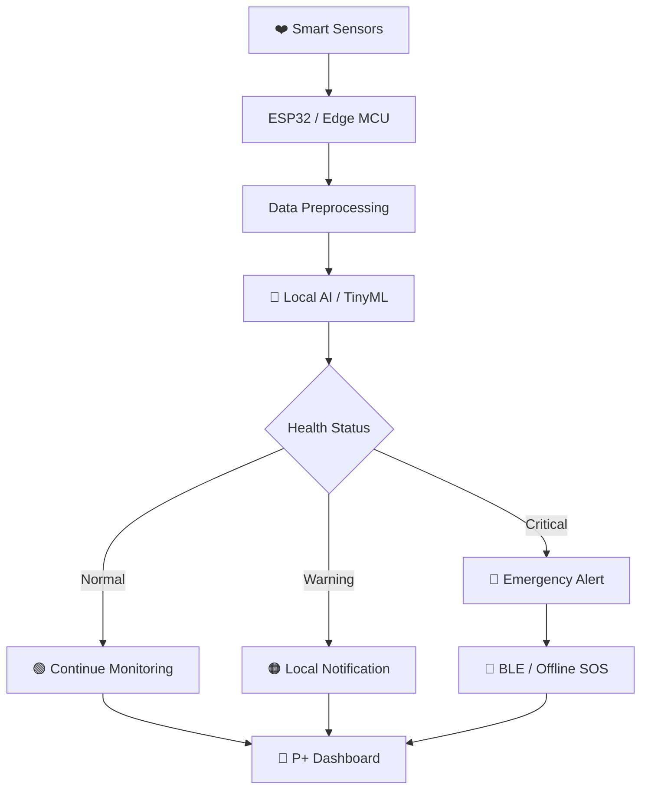
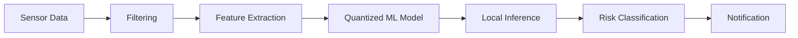

<div align="center">


# 🧬 P+ | Personal Health Intelligence

### Your Health. Your Data. Your Control.


<br/>


[🚀 Explore Project](#-core-features) •
[🧊 3D Experience](#-3d-model-experience) •
[🏗️ Architecture](#️-system-architecture) •
[🛠️ Setup](#️-getting-started)

</div>

---

## 🧠 About P+

**P+** is a privacy-first Personal Health Companion designed to monitor important health signals, recognize potentially concerning patterns, and help users respond to risks in a timely manner.

P+ is being developed around local processing, smart sensors, edge AI, and offline-capable communication rather than depending entirely on cloud-based AI services.

> **Sense → Analyze → Alert → Protect**

<div align="center">

| ❤️ Vital Signs | 🧍 Posture | 🧠 Edge AI | 🚨 Safety |
|:---:|:---:|:---:|:---:|
| Health metrics | Posture insights | Local inference | Emergency alerts |

</div>

---

## 🧊 3D Model Experience

<div align="center">

<!--
Add your 3D model preview image or GIF to:
assets/p-plus-3d-preview.gif

Replace the link below with your actual interactive model URL
from a service such as Sketchfab.
-->

<a href="YOUR_INTERACTIVE_3D_MODEL_URL">
  
</a>

### Explore the P+ 3D Concept

*A futuristic health companion visual featuring a 3D heart,
sensor-inspired elements, and an emerald-green interface.*

**[Open the Interactive 3D Model →](YOUR_INTERACTIVE_3D_MODEL_URL)**

</div>

> **Setup:** Replace `YOUR_INTERACTIVE_3D_MODEL_URL` with your actual hosted model URL and add a preview GIF at `assets/p-plus-3d-preview.gif`. GitHub README files do not execute embedded JavaScript or WebGL viewers directly, so the link opens the interactive model separately.

---

## ✨ Core Features

<table>
<tr>
<td width="50%">

### ❤️ Health Monitoring

- Heart-rate monitoring support
- SpO₂ sensor integration
- Activity and health indicators
- Live monitoring interface

</td>
<td width="50%">

### 🧍 Posture Intelligence

- Posture-angle tracking
- Configurable alert thresholds
- Slouch detection concept
- Posture history and analytics

</td>
</tr>
<tr>
<td width="50%">

### 🧠 Edge Intelligence

- Local data processing
- TinyML model integration
- Sensor-data preprocessing
- Potential risk classification

</td>
<td width="50%">

### 🚨 Safety & Privacy

- Local-first architecture
- BLE communication design
- Offline SOS development path
- User-focused health alerts

</td>
</tr>
</table>

---

## 🏗️ System Architecture



---

## ⚡ How P+ Works

<div align="center">

| Stage | Process | Purpose |
|:---:|---|---|
| 01 | Sensor Collection | Gather available health and motion signals |
| 02 | Data Processing | Filter and prepare sensor measurements |
| 03 | Edge Intelligence | Analyze features locally where supported |
| 04 | Risk Evaluation | Apply configured rules and validated models |
| 05 | Alert Generation | Notify users about detected conditions |
| 06 | Safety Communication | Support device communication and SOS workflows |

</div>

---

## 🧍 Smart Posture Detection

P+ includes a configurable posture-monitoring concept.

```text
Posture angle exceeds configured threshold
                    ↓
       Start duration measurement
                    ↓
        Condition persists for 10 s
                    ↓
          Local alert generated
                    ↓
        User receives notification
```

Example configuration:

| Setting | Example |
|---|---|
| Posture threshold | 15° |
| Duration | 10 seconds |
| Processing | Local, where implemented |
| Notification | App alert / vibration, where supported |

*Thresholds and behavior must be validated with the actual hardware and sensor calibration.*

---

## 🧠 Edge AI Pipeline



P+ is designed to explore lightweight inference using quantized models and embedded hardware. Actual model deployment and inference capabilities depend on the selected device and implementation.

---

## 🔐 Privacy-First Design

<div align="center">

```text
        USER / WEARABLE
               |
               v
        SENSOR COLLECTION
               |
               v
        LOCAL PROCESSING
               |
               v
        EDGE RISK ENGINE
               |
          +----+----+
          |         |
          v         v
        NORMAL    ALERT
          |         |
          v         v
       DASHBOARD   SOS
```

</div>

**Privacy goals**

- Minimize unnecessary data transmission.
- Keep processing local whenever practical.
- Avoid mandatory cloud AI dependencies.
- Design secure device pairing and data handling.
- Support offline workflows where hardware permits.

---

## 🛠️ Technology Stack

<div align="center">

### Frontend


### Backend


### AI / Machine Learning


### Hardware & IoT


</div>

*The technologies shown represent the project stack and development direction; verify each component against the current implementation.*

---

## 📱 Application Experience

P+ includes interface concepts for:

- 🔑 Login and profile
- 🏠 Health dashboard
- 📊 Live monitoring
- 🧍 Posture analytics
- ❤️ Vital-sign indicators
- 🔔 Notifications and alerts
- 🩺 Future doctor portal integration

---

## 📂 Project Structure

```text
P-PLUS/
│
├── assets/
│   ├── p-plus-3d-preview.gif
│   ├── screenshots/
│   └── images/
│
├── data/
├── stitch_p_health_companion_app/
│
├── app.js
├── server.js
├── local_server.js
├── index.html
│
├── style.css
├── styles.css
├── input.css
├── tailwind.css
│
├── tailwind.config.js
├── package.json
├── package-lock.json
└── README.md
```

*Adjust this structure to match the files actually present in the repository.*

---

## ⚙️ Getting Started

### 1. Clone the repository

```bash
git clone https://github.com/ts042049-cpu/P-PLUS.git
cd P-PLUS
```

### 2. Install dependencies

```bash
npm install
```

### 3. Start the application

Check the available scripts in `package.json`. If the project defines a `start` script, run:

```bash
npm start
```

Otherwise, use the appropriate entry point, such as `node server.js`, if configured for direct execution.

---

## 🗺️ Development Roadmap

- [x] Initial interface concepts
- [x] Dashboard design
- [x] Posture monitoring concept
- [x] Local development foundation
- [ ] Hardware sensor integration
- [ ] Edge ML deployment
- [ ] BLE device communication
- [ ] Offline SOS implementation
- [ ] End-to-end testing
- [ ] Field validation

---

## 🌍 Real-World Applications

<div align="center">

| ☀️ | 🌫️ | 🌊 | 🏃 | 👴 |
|:---:|:---:|:---:|:---:|:---:|
| Heat awareness | Pollution awareness | Disaster resilience | Outdoor workers | Elderly support |

</div>

P+ aims to support health awareness in challenging environments, including heat waves, pollution events, and situations where internet access may be limited.

---

## 🛡️ Important Note

P+ is a developing technology project, not a certified medical device. Its alerts and measurements must not be treated as a medical diagnosis or a replacement for professional care. Hardware integration, model accuracy, and safety workflows require testing and validation.

---

<div align="center">


# 🧬 P+

### Detect Earlier. Understand Smarter. Protect Better.

**Personal Health. Reimagined.**

⭐ If you like the project, consider giving the repository a star.

Made with ❤️ + 🧠 + ⚡

</div>
